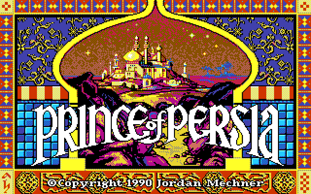
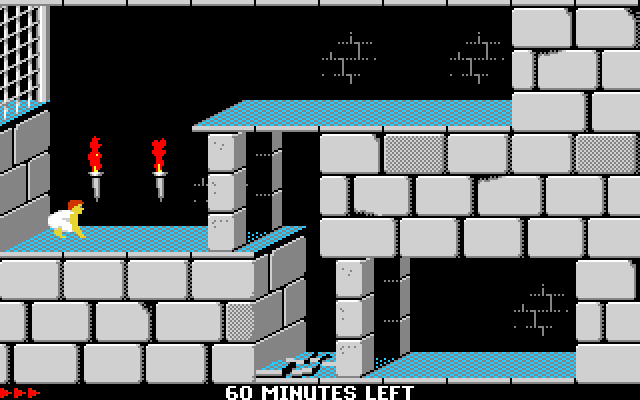
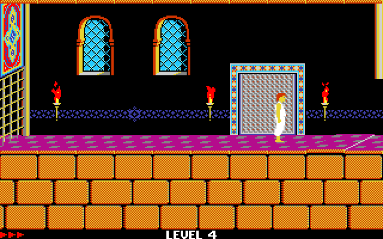
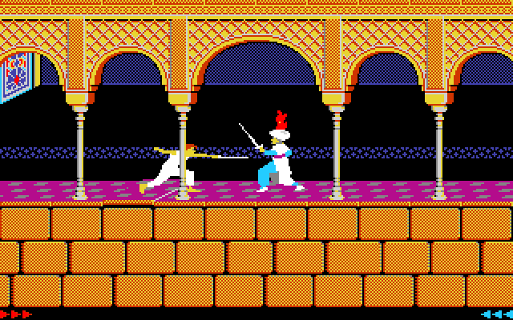
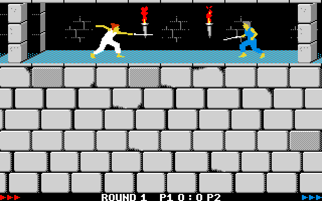
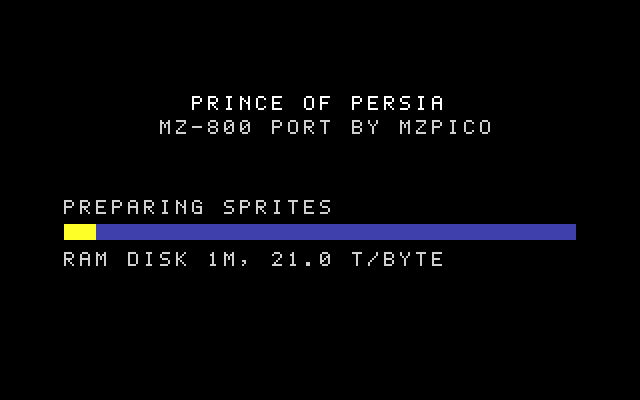

# Prince of Persia for the Sharp MZ-800

A fan port of **Prince of Persia** (Jordan Mechner, Brøderbund, 1989) to the **Sharp MZ-800**: the complete game,
all 14 levels with the guards, the traps, the shadow, the cutscenes, the music and the sound, in 320x200 with 16
colours, plus a two-player sword duel hidden behind the title. It is a non-commercial fan project by MZPico; it is not
affiliated with or endorsed by the owners of Prince of Persia.

| | |
|---|---|
|  |  |
|  |  |

## What you need

- **A Sharp MZ-800 with the 32 KB VRAM extension (MZ-1R25).** The game uses the 320x200 16-colour mode, which needs
  the extension; without it the loading screen says so and stops.
- **A chip-based RAM disk card of 512 KB or more**: real RAM chips, such as an MZ-1R18-style card, with close to zero
  wait states. **An emulated or file-backed RAM disk, such as the MZPico's, is not supported** (see
  [Known limitations](#known-limitations)). The game keeps its graphics there; a bigger card only makes it faster, the
  game is the same:

  | RAM disk card | What you get |
  |---|---|
  | 512 KB | the minimum: the whole game, the slowest |
  | 1 MB (or 2 MB) | **recommended**: the prince's and the level's guards' animation frames are prepared in the RAM disk while the game loads (about 7 s), so walking and fighting are smoother |
  | 4 MB or more | the fastest: more of the prince's frames, every guard's frames and the trap pictures are prepared and kept (about 20 s on the loading screen) |

  The loading screen measures the RAM disk's speed in wait states (`WS`: 0 is a card without waits); one slower than
  15 WS stops the start with `RAM DISK TOO SLOW: ... WS`.
- **A floppy drive or the MZPico's floppy emulation** for the disk image (one 320 KB disk). The game also saves your
  progress to it.
- **Optional: an MZPico card**, for the duel over the network (and, if you like, as the floppy drive). It does not
  replace the RAM disk card.
- A joystick is optional: the keyboard plays everything.

## Getting the game

Download the disk image `pop800-X.Y.Z.dsk` from the
**[Releases page](https://github.com/MZPico/mz800pop/releases)**. The first release, 0.1.0, is coming soon; until
then the disk can only be built from the source (see [For developers](#for-developers)). Each release comes with the
disk's checksum file `pop800-X.Y.Z.dsk.sha256`; `sha256sum -c pop800-X.Y.Z.dsk.sha256` checks your download.

<!-- TODO: link the title's page on mzpico.com (play in the browser) once it is public there; today it is on staging only. -->

## Starting it

1. Put the disk image in the first floppy drive: write it to a real disk, or select it in the MZPico's floppy
   emulation.
2. Switch on (or reset) the MZ-800 and let it boot from the floppy. Keep the disk writable if you want to save games.
3. The **loading screen** shows:
   - the game's version under the title (`V0.1.0`);
   - a progress bar while the game loads (`LOADING...`) and, with 1 MB or more, while it prepares the animation
     frames (`PREPARING SPRITES`);
   - the RAM disk it found and its speed in wait states (`RAM DISK 1M, 0 WS`; 0 WS is a card without waits);
   - whether an MZPico network is there for the duel (`NETWORK: MZPICO NET (DUEL: CTRL+D)` or
     `NETWORK: NONE (DUEL: CTRL+D)`).
4. Then the title and the intro play. Press any key, or the joystick's fire, for a new game; **Ctrl+L** continues your
   saved game.

## Playing in an emulator

The game runs in **mz800emu**; the version the project tests with is MZPico's
([MZPico/mz800emu](https://github.com/MZPico/mz800emu), branch `wasm`). The settings it needs:

- **RAM disk:** MZ-1R18 connected, size 1 MB (or 512 KB, 2, 4, 8 or 16 MB; MZPico's build adds 2, 4 and 8 MB), no
  extra wait states. This emulates a chip-based card.
- **VRAM:** mz800emu emulates the 32 KB VRAM extension; nothing to set.
- **Floppy:** insert the disk image into drive FD0, then reset. Work on a copy: the emulator writes the disk back
  (saved games), and it may do so even when the disk is marked read-only.
- **Joystick (optional):** mz800emu can play joystick 1 on the PC's numeric keypad.

`emu/mz800emu.ini` in this repository is a complete configuration with these settings.

## Controls

| Action | Keyboard | Joystick |
|---|---|---|
| Run, jump, climb, crouch | cursor keys | stick (port 1) |
| The action button: careful step, hang on, pick up, drink, strike with the sword | SHIFT | fire |
| Show the time left | SPACE | |
| Pause (any key resumes) | BREAK | |
| Restart the level | Ctrl+A, or ENTER after you die | |
| Save the game (levels 3 to 13) | Ctrl+G | |
| Load the saved game | Ctrl+L on the title | |
| Sound on / off | Ctrl+S | |
| Back to the title | Ctrl+R (or Ctrl+Q) | |
| Show the version | Ctrl+V | |
| Skip to the next level (levels 1 to 3 only, as in the original) | SHIFT+L | |

You have 60 minutes to rescue the princess, as in the original; the clock runs only while you play.

## The duel: a two-player easter egg

Press **Ctrl+D on the title** for a sword duel: the prince against a second prince in a blue suit (the screenshot at
the top, with the round and the score on the bottom line). Every round the prince starts on the right and the blue
prince on the left, facing each other.

- **Without an MZPico** the local duel starts at once, both players on one MZ-800.
- **With an MZPico** you choose: `1 LOCAL`, `2 HOST` or `3 JOIN` (BREAK goes back to the title).

| | Player 1 (the prince) | Player 2 (the blue prince) |
|---|---|---|
| Move | cursor keys, or joystick 1 | W A S D, or joystick 2 |
| Button (draw, strike) | `/` or `?`, or joystick 1's fire | Q, or joystick 2's fire |

After a match: **ENTER** for a rematch, **BREAK** back to the title.

The swords are drawn and put away by hand:

- Every round starts with both swords **sheathed**.
- **Draw:** press the button alone while standing. If your opponent is behind you, you turn round and draw in one go.
  With a potion right in front of you, the button drinks it first; press again to draw.
- **Put the sword away:** down, en garde. Nothing puts it away for you, not even winning a round.
- The button with a direction works as in the game (with forward: the careful step).
- **A player hit while the sword is sheathed dies at once.**

The rules in short:

- Each round both players have **3 hit points**; the first to win **3 rounds** (best of 5) takes the match. A round
  where both fall at once is a draw and is played again.
- When both strike at the same moment, the blades **clash** and nobody is hurt.
- Every match is in a **random level**, every round in a random room of it, dungeon or palace.
- Every other round a **pair of potions** stands on the floor, one for each player: healing, a longer life, or
  poison. Stand in front of yours with the sword sheathed and press the button to drink it.
- Some rooms have **spikes**, and every third round some are added. Running, jumping or falling onto them kills as in
  the game. Careful steps over raised spikes are safe, and so is everything with the sword drawn; only other moves onto
  raised spikes with the sword sheathed (a turn, a hop) cost a hit point.

**Over the network** (MZPico, through the MZPico NET service; each MZ-800 still needs its own RAM disk card): one player picks `2 HOST` and gets a four-letter
`ROOM CODE`; the other picks `3 JOIN`, types the code (DEL deletes) and presses ENTER. The match starts when both are
in. Each machine plays its own fighter with either set of keys (SHIFT fires too); the host is the prince. Both
machines must boot the same release of the disk (`OTHER VERSION` otherwise). Other messages: `NO SUCH ROOM` (a wrong
code), `NO LINK` (no connection to the service), `OTHER PLAYER LEFT`, `CONNECTION LOST`, and `DESYNC` (a bug: please
report it). In emulators the network duel needs a relay running on your PC: see
[docs/duel-net-howto.md](docs/duel-net-howto.md).

## Known limitations

- **Room changes pause** for a moment (one to two seconds) while the next room is drawn, and busy rooms (several traps and
  gates moving) run slower than the rest of the game.
- The game runs slower than the PC original in general, and a smaller RAM disk is slower again (see above).
- Not in this port: the original's attract-mode demo and the hall of fame.
- **The RAM disk must be a fast, chip-based card**, with close to zero wait states: the game reads its graphics from
  it all the time. Emulated or file-backed RAM disks, such as the MZPico's, are not supported, even though the MZPico
  itself works for the floppy and the network. The boot measures the RAM disk's speed and stops with
  `RAM DISK TOO SLOW: ... WS` (and the measured figures) when it is slower than 15 wait states.
- A 256 KB RAM disk card is not enough.

## For developers

The port is written in Z80 assembly and built on a PC from the original DOS game's data files, which you must supply
yourself: they are not in this repository. Start with [docs/DEVELOPING.md](docs/DEVELOPING.md) (the source layout, the
requirements, the `make` targets and the tests). More:

- [PLAN.md](PLAN.md): the port's plan, decisions and history;
- [docs/ci.md](docs/ci.md): the build and test pipeline on GitHub's runners;
- [docs/memory.md](docs/memory.md), [docs/perf.md](docs/perf.md), [docs/ramdisk-tiers.md](docs/ramdisk-tiers.md):
  the memory map, the speed work, the RAM-disk sizes;
- [docs/m7-design.md](docs/m7-design.md): the title, cutscenes, sound and keys;
- [docs/duel-design.md](docs/duel-design.md), [docs/duel-net-howto.md](docs/duel-net-howto.md): the duel;
- [docs/research/](docs/research/): the research notes behind the port.

## Credits and licence

- **Prince of Persia** was created by **Jordan Mechner** and published by **Brøderbund** in 1989. The graphics,
  levels, sound and music used here come from the original DOS version (1.3); Prince of Persia and its content remain
  the property of their owners.
- The game logic follows **SDLPoP** by David Nagy and its contributors, the open-source reconstruction of the DOS game.
  [Sergey Potapov's ZX Spectrum 128K port](https://github.com/PotapovSergey77/POP_Spectrum_128K) was studied early on.
- The music in the title and the cutscenes is arranged from the Sega Master System version's soundtrack.
- The network duel uses the MZPico NET service of [BomberNet](https://github.com/MZPico/BomberNet).
- The MZ-800 port: MZPico.

The port's own code, tools and documentation are licensed under the **GNU General Public License v3.0**
([LICENSE](LICENSE)); parts derived from [SDLPoP](https://github.com/NagyD/SDLPoP) are GPL-3 as SDLPoP is. The licence
does not cover the original game: its data is not in this repository, and the build reads it from the developer's own
copy.
